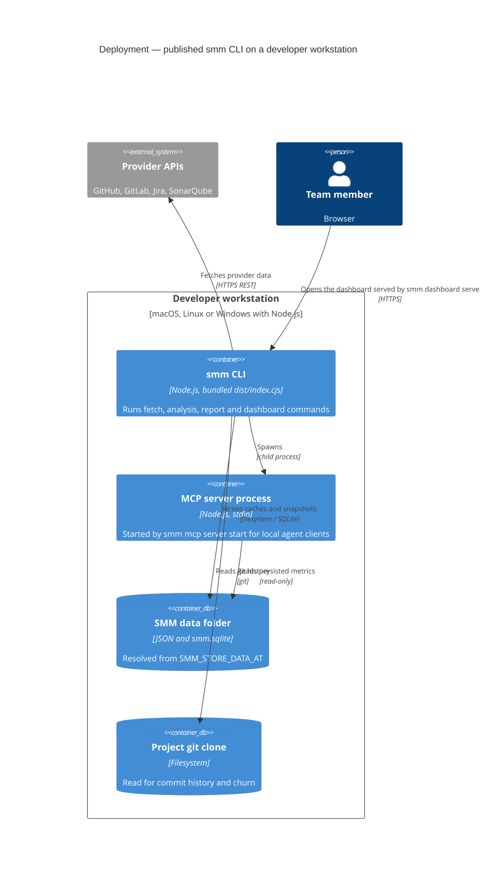
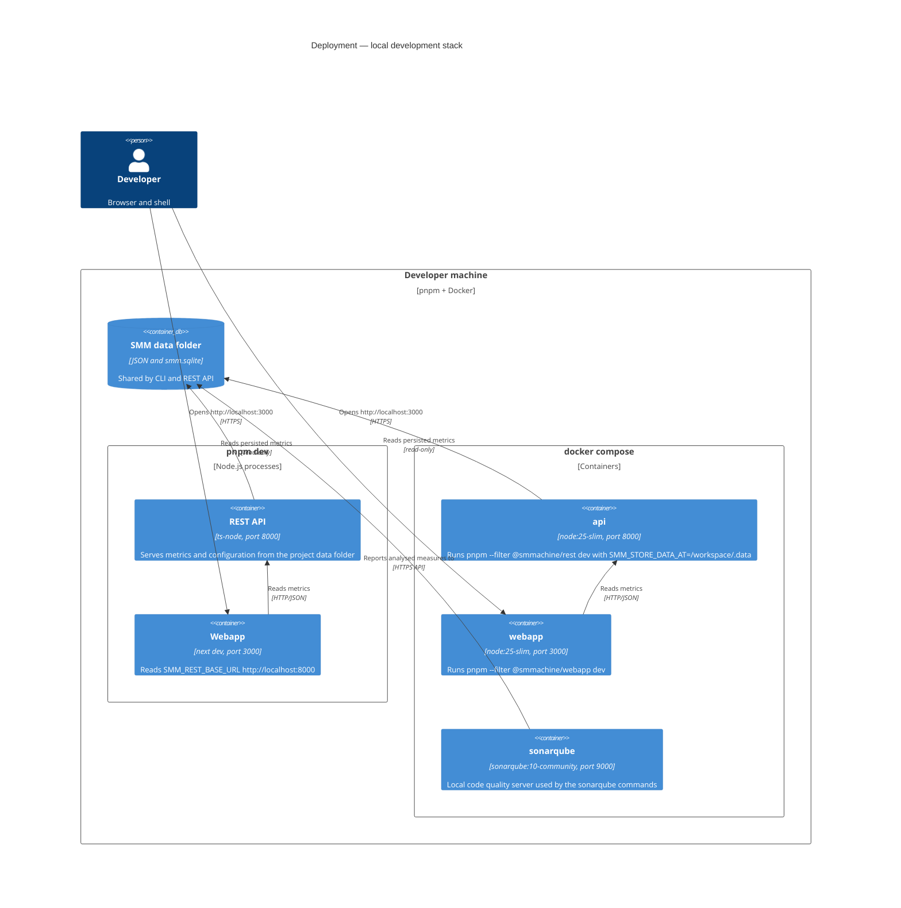

# Deployment

Two deployment shapes matter day to day: the **published CLI** (what users install) and the **local development
stack** (`pnpm dev` or `docker compose`).

## Published CLI

`smm dashboard serve` starts two child processes from the published bundle: the REST API on port `3001` and the
Next.js server on port `3000`. The webapp receives `SMM_REST_BASE_URL=http://<host>:3001`, so no extra configuration is
needed.

## Local development stack

Both stacks are read-only: they serve whatever the CLI persisted under `SMM_STORE_DATA_AT`. For a full local run,
execute the CLI commands first (`smm project configure`, `smm change-requests fetch`, `smm pipelines fetch`,
`smm architecture generate`), then start the stack.

Back to the architecture index: see `README.md` in this folder.
