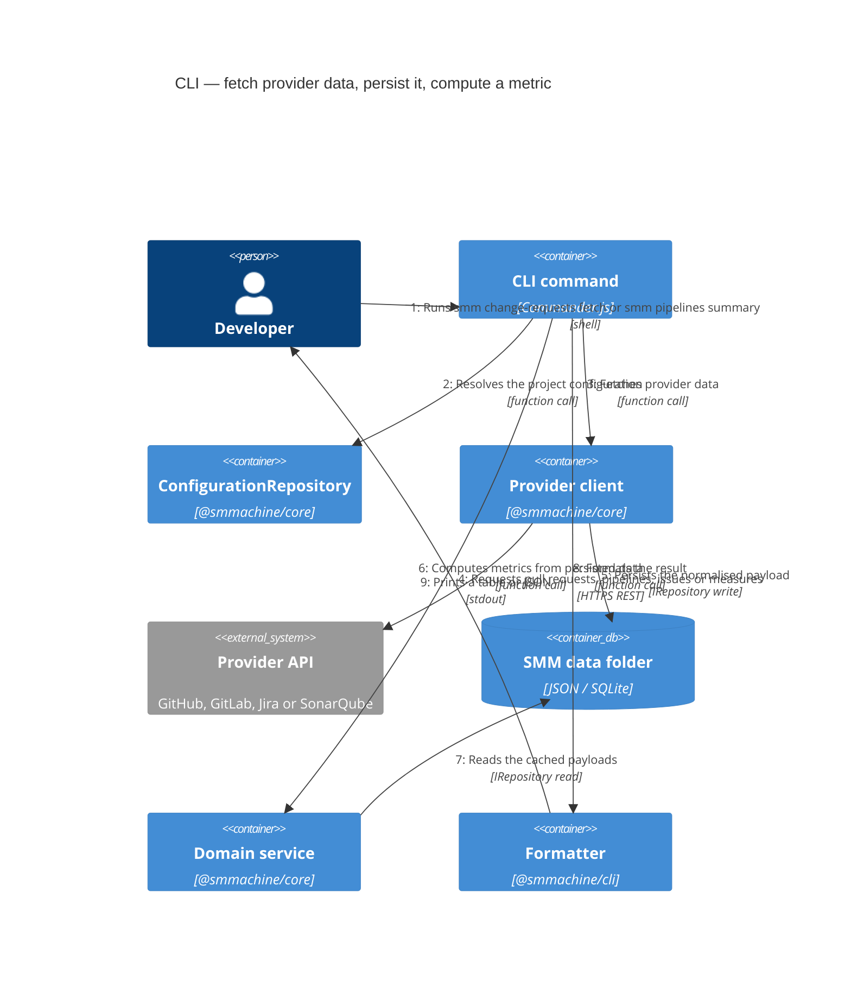
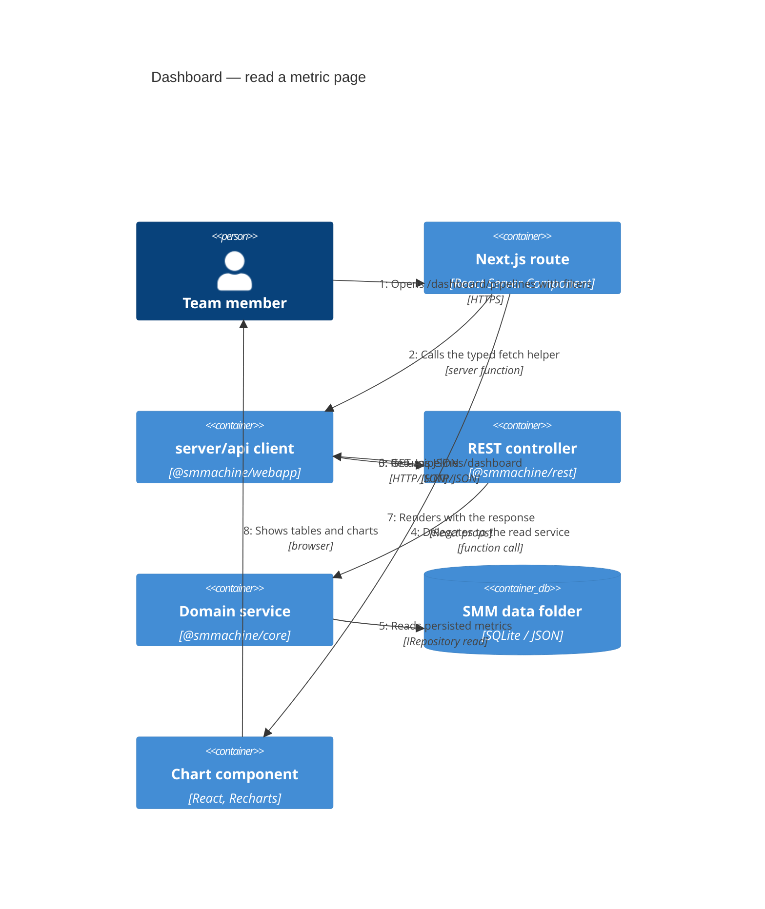
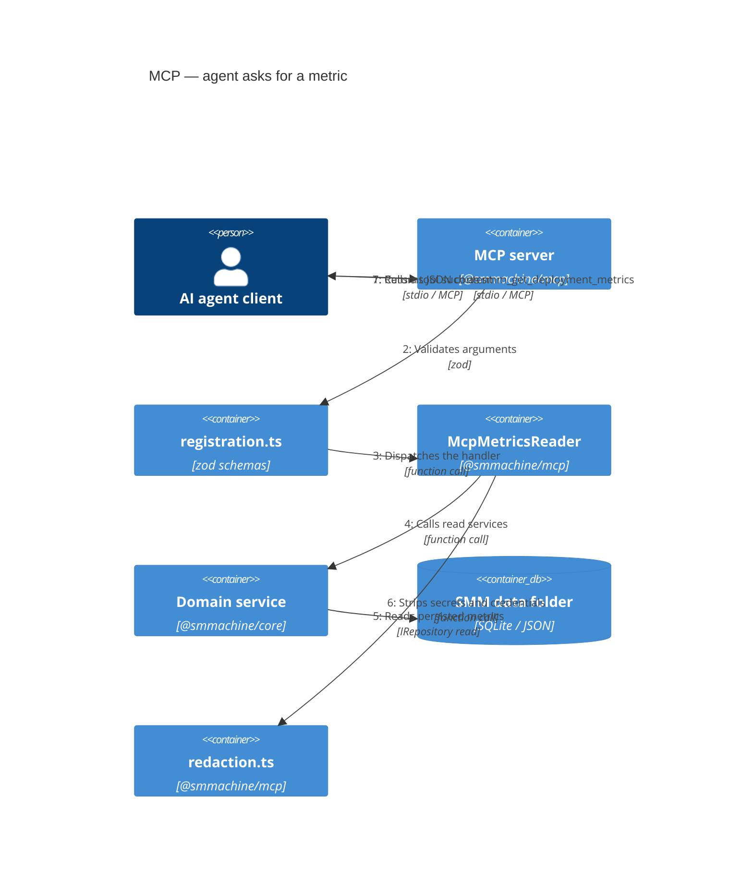

# Dynamic views

Static diagrams show what exists; dynamic diagrams show the order of calls. These three flows cover every way to use
SMM: fetch and analyse from the CLI, read the dashboard, and read through MCP.

## Flow 1 — CLI fetches data and computes a metric

The order matters: **fetch writes, computation reads**. That is why a second command can re-run the analysis without
touching the provider API, and why `--refresh` options exist on fetch commands.

## Flow 2 — Dashboard read path

No provider is called during a dashboard request. A slow or rate-limited provider never blocks the UI, but it also
means the dashboard only shows data that was fetched by the CLI before.

## Flow 3 — MCP read path

Next: [Deployment](./deployment.md).
