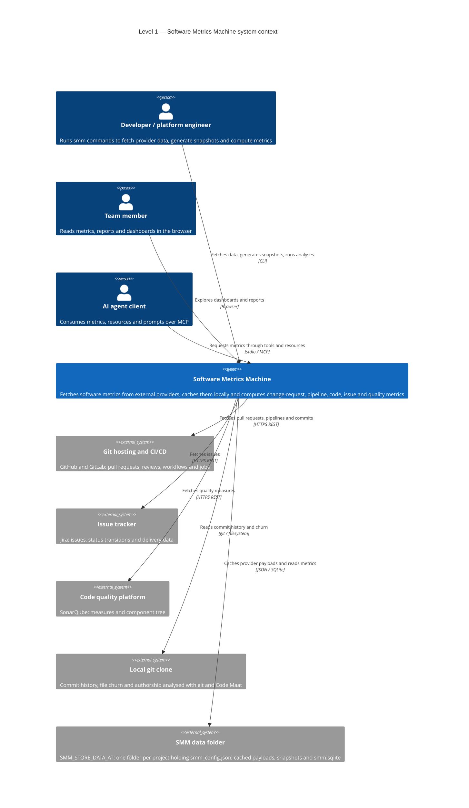

# Level 1 — System context

The system context is the "one diagram for the whole product" view. It answers three questions before any code is
read:

1. Who uses SMM?
2. What is SMM responsible for?
3. Which external systems does it depend on?

## What to notice

- **Three entry points, one product.** The CLI, the dashboard and the MCP server are different front doors to the same
  metric model. A metric is implemented once in `packages/core` and surfaced by every front door.
- **Everything external is a provider.** GitHub, GitLab, Jira, SonarQube, the local git clone and Code Maat are
  interchangeable data sources behind a provider client. Adding a data source never changes the metric definitions.
- **The data folder is part of the contract.** SMM is local-first: fetched payloads and computed metrics are stored
  under `SMM_STORE_DATA_AT`, so dashboards and agent clients can read results without calling third-party APIs again.
- **Only one component writes.** Write access to the data folder is reserved for the CLI. The REST API, webapp and MCP
  server only read what was already fetched or generated. The rule is documented under "Data mutability boundary" in
  `AGENTS.md` and `CONTRIBUTING.md`.

Next: [Level 2 — Containers](./level-2-containers.md).
