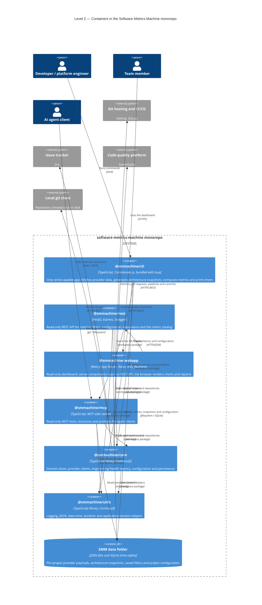

# Level 2 — Containers

The container diagram zooms into the monorepo and shows the deployable/runnable units plus the two shared libraries.
It is the most useful diagram when you are deciding **where** a change belongs.

## Container responsibilities

| Container | Module system | Runtime | Writes to `SMM_STORE_DATA_AT`? |
|-----------|---------------|---------|--------------------------------|
| `@smmachine/cli` (`apps/cli`) | CommonJS, bundled by tsup | Local shell | Yes — the only writer |
| `@smmachine/rest` (`apps/rest`) | CommonJS, NestJS | HTTP server | No |
| `@smmachine/webapp` (`apps/webapp`) | ESM, Next.js | HTTP server | No (it only talks HTTP to REST) |
| `@smmachine/mcp` (`apps/mcp`) | CommonJS, tsup | stdio server | No |
| `@smmachine/core` (`packages/core`) | CommonJS library | In-process | Only through repositories when invoked by the CLI |
| `@smmachine/utils` (`packages/utils`) | CommonJS library | In-process | No |

## What to notice

- **`apps/*` are adapters, `packages/*` hold the logic.** Command groups, controllers, MCP tools and React components are
  thin translation layers. Metric math lives in `packages/core`.
- **The webapp never imports `@smmachine/core`.** It reaches the data through `apps/webapp/server/api/*.ts`, which
  calls the REST API at `SMM_REST_BASE_URL`. This keeps the dashboard deployable on its own and enforces the read-only
  boundary.
- **The CLI also depends on `@smmachine/mcp`** so `smm mcp server start` can boot the server without a separate
  package.
- **`smm dashboard serve` bundles the stack.** The published CLI spawns the bundled REST API (default port `3001`) and
  the Next.js server (default port `3000`), wiring `SMM_REST_BASE_URL` for the webapp.

Next: [Level 3 — Core components](./level-3-components-core.md) and
[Level 3 — Application components](./level-3-components-apps.md).
