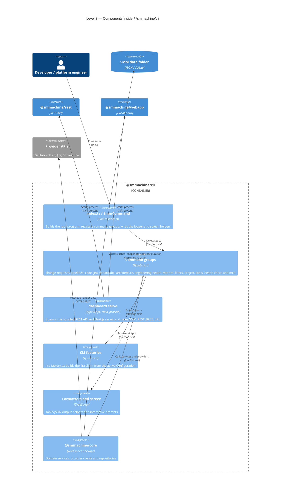
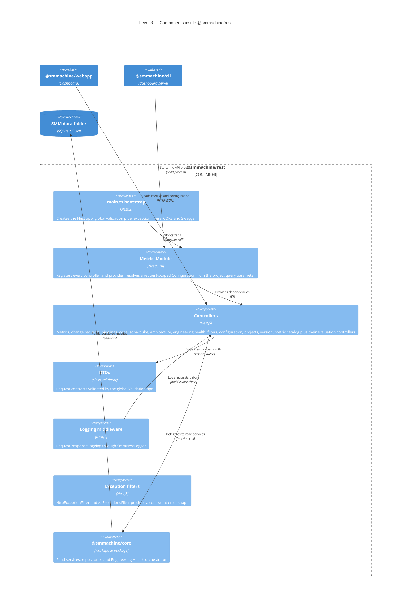
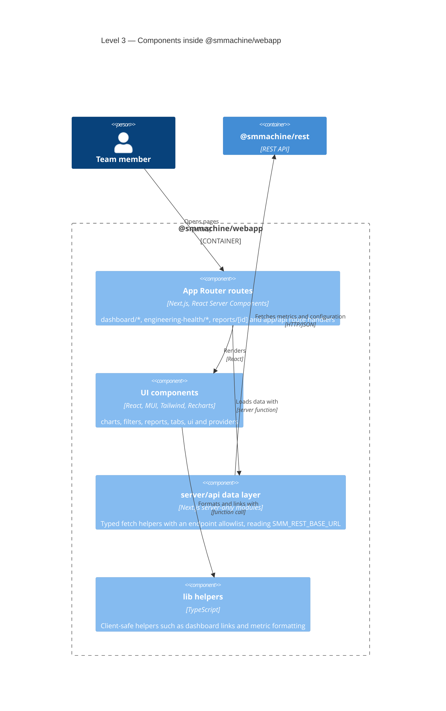
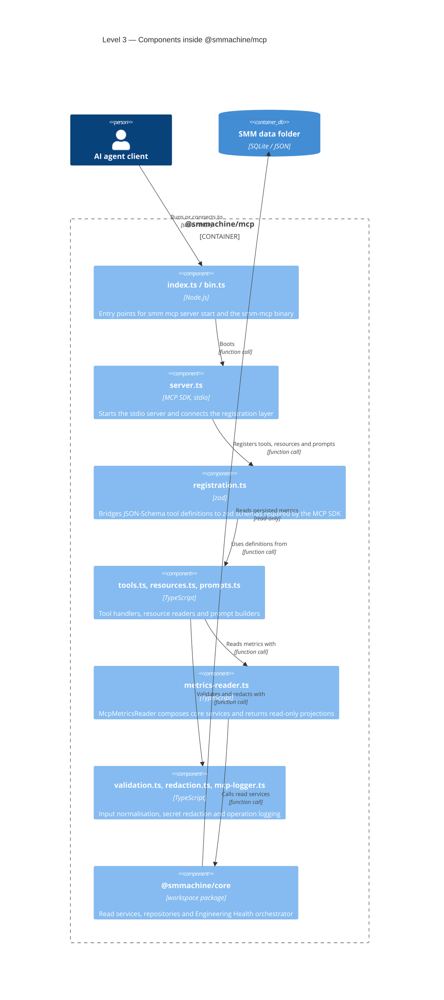

# Level 3 — Application components

These diagrams zoom into each application. Read the one that matches the change you are making; you rarely need more
than one at a time.

## CLI (`apps/cli`)

A command is intentionally boring: parse options into a typed filter object, call one service, format the result. If a
command needs branching logic, that logic belongs in `packages/core`.

## REST API (`apps/rest`)

There is no write path here. If an endpoint seems to need one, the data must be fetched or generated by a CLI command
first.

## Dashboard (`apps/webapp`)

`@smmachine/core` and `@smmachine/utils` are **devDependencies for typing only** here. Importing them from `app/`,
`components/`, `server/` or `lib/` fails `apps/webapp/__tests__/server-code-boundary.test.ts`.

## MCP server (`apps/mcp`)

The MCP server exposes no generation tools. It is a projection of whatever the CLI already persisted, with credentials
stripped by `redaction.ts`.

Next: [Dynamic views](./dynamic-views.md) to see these components in motion.
