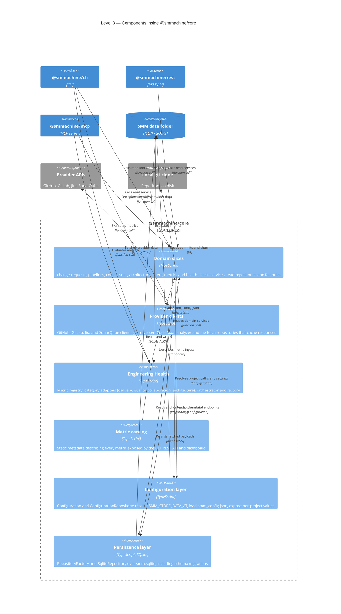

# Level 3 — Core components

`@smmachine/core` is where the product actually lives. This diagram shows its internal building blocks; every other
container either calls it or renders its output.

## Domain slices (`packages/core/src/domain/<area>/`)

Every area follows the same layout, so a new feature is added by copying the shape instead of inventing one:

| Folder | Contents |
|--------|----------|
| `services/` | Pure business logic. Accept typed filters, return domain types, no I/O |
| `repositories/` | Read repositories over the persisted data (JSON/SQLite), used by CLI, REST and MCP |
| `factories/` | Wire configuration to repositories and services |
| `infrastructure/` | Slice-specific adapters |
| `__tests__/` | Vitest specs for the slice |

The current slices are `change-requests`, `pipelines`, `code` (with `big-o`, `codemaat`, `git`, `pairing` and
`sonarqube` sub-areas), `issues`, `architecture`, `filters`, `metrics` and `health-check`.

## Two kinds of repository

New joiners are usually surprised by this split, and it is deliberate:

- **Fetch repositories (`packages/core/src/providers/<vendor>/`)** call external APIs, normalise the payload and cache
  it. They are only used by the CLI, because they write.
- **Read repositories (`packages/core/src/domain/<area>/repositories/`)** read the cached data. They are safe for the
  REST API, the webapp (indirectly) and the MCP server.

Keeping the two apart is what makes the read-only boundary in
[Level 2 — Containers](./level-2-containers.md) enforceable.

## Engineering Health

`engineering-health/` composes metric definitions without duplicating any calculation:

- `registry.ts` registers every metric id.
- `adapters/` groups metrics by category: `delivery`, `quality`, `collaboration`, `architecture`.
- `orchestrator.ts` evaluates a metric (or all metrics) against an input.
- `factory.ts` builds the orchestrator with its dependencies (`dependencies.ts`).

A new metric becomes an Engineering Health metric by reusing an existing domain service and registering an adapter.

## Persistence and configuration

- `infrastructure/configuration.ts` defines `Configuration` (tokens, endpoints, dates, timezone, logging level).
- `infrastructure/configuration-repository.ts` resolves `SMM_STORE_DATA_AT`, loads `smm_config.json` and returns a
  `Configuration` per project.
- `infrastructure/repository-factory.ts` + `sqlite-repository.ts` persist domain data in `smm.sqlite` inside the
  project folder. Schema changes are tracked in `smm_schema_migrations`.
- Raw provider caches and `saved-filters.json` remain plain files, which is why the data folder contains both JSON and
  SQLite artefacts.

Next: [Level 3 — Application components](./level-3-components-apps.md).
